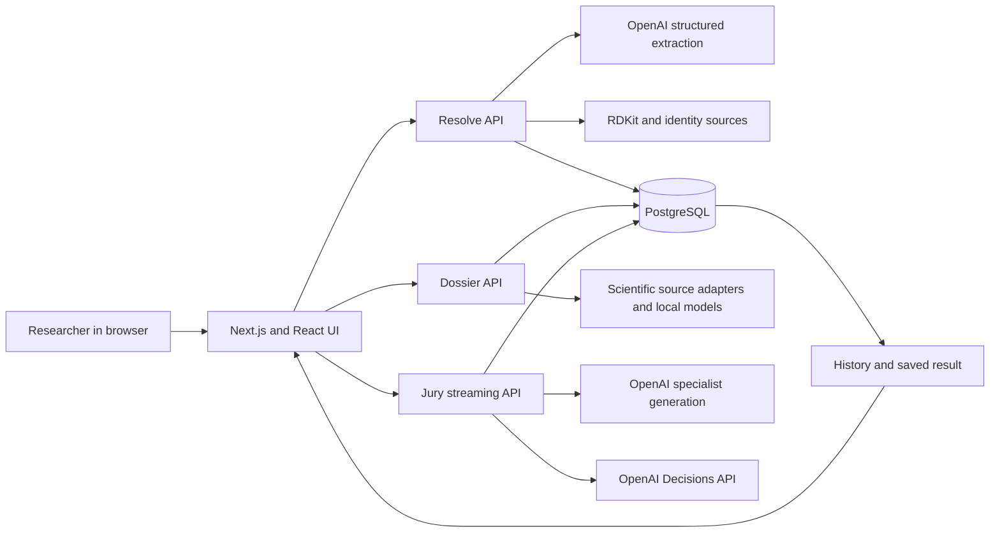

# MoleculeJury Product and System Story

**A complete account of the problem, product, design, architecture, evidence flow, and decision system**
**As built on `dev`, 28 October 2026, commit `61052a5`**

## The idea in one minute

Research questions about medicines and biological targets rarely arrive as clean database queries. A user may name a drug, describe an adverse observation, attach a structure, ask whether a target is worthwhile, and leave out the exact dose or experimental setting. A compound can have a valid structure while the claimed benefit remains unproven. A safety alert can be plausible without being measured. A paper can be relevant to the molecule but irrelevant to the user's use case.

MoleculeJury turns that messy starting point into a **traceable research decision**. It separates the question and use case from the molecular entities, verifies any structure it can show, assembles numbered evidence, lets five specialist roles challenge the case, and asks the OpenAI Decisions API for the final GO, CAUTION, or NO_GO assessment. The result is presented as a short review, an interactive structure, and a decision card, followed by suggested checks and source links.

The product is a **research triage workspace**. Its percentages represent the Decisions API's judgment distribution for the research question. They are not probabilities that a medicine will work for an individual, or that it is safe.

## 1. The problem and the intended user

The underlying problem is fragmentation. Identity, composition, biological target, assay activity, warnings, model predictions, literature, and the limits of each source sit in different systems. A useful answer must connect those records to **the precise issue the user asked**. Returning a generic caution statement or a dense list of facts makes the decision harder to inspect.

The primary user is a researcher or scientific reviewer exploring a molecule, protein, combination, or broader biomedical question. A good run should answer five questions quickly:

1. **What exactly was submitted?** What is the question, use case, issue, and reported observation?
2. **What identity was verified?** Which named medicine, molecule, or protein maps to a reliable record or supplied structure?
3. **What evidence applies?** Which facts are measured, annotated, predicted, heuristic, or supplied by the user?
4. **What is the research decision?** Why GO, CAUTION, or NO_GO for this use case?
5. **What would change the answer?** Which focused experiments or source checks come next?

MoleculeJury preserves the difference between **identity evidence** and **outcome evidence**. A PubChem match can justify showing a chemical drawing. It does not establish efficacy. A protein's PDB structure can make the target tangible. It does not prove that a proposed drug binds it.

## 2. The experience from first visit to saved result

The application has three top-level destinations: **Overview**, **New analysis**, and **History**. A fixed top bar stays in place while the page scrolls. Clicking the MoleculeJury logo returns to Overview. The current UI is implemented in [Shell](../components/Shell.tsx), [Overview](../components/Overview.tsx), and [global styles](../app/globals.css).

**Overview** states the problem first. It shows the five reviewers around a table and a short capabilities section below. Selecting a reviewer reveals the role's name, discipline, description, and specifications in the chamber area. The scene has idle motion and a one-time entry sequence per browser session.

**New analysis** centers a large research prompt with one short instruction line. The user can type a question, paste an image, drag in or attach a supported file, and attach up to four saved analyses as context. The draft is held in the shell's state while navigating tabs. Clicking Analyze starts resolution and dossier creation without an extra confirmation step. The page scrolls to the chamber during the discussion and then to the result when the ruling is ready. The original prompt remains above for reference and editing; a changed prompt becomes a new analysis when submitted.

**The chamber** shows the five characters around a table. The active reviewer's dialogue appears in the scene, and the ordered transcript appears below. The first three specialists open in parallel; Doubt challenges a specialist; that specialist rebuts; the Decisions API evaluates the case; Gavel explains its result. On completion the chair's gavel animates, a synthesized strike sound plays, and the result appears. The CSS scene is an illustrated, perspective-styled composition of body parts, chairs, and a table; it is **not a rigged 3D character engine**. The chemical and protein visualization is a separate scientific renderer.

**The result** uses three adjacent cards on a wide screen: brief review, structure explorer, and final assessment. Suggestions follow, then citations. On narrower screens the cards reflow. The review names the decision reason and main limitation. The structure card lets the user switch among verified entities and between available 3D and 2D molecule views. The final card highlights the Decisions API call, choice bars, confidence, evidence grade, coverage, and three rubric scores.

**History** lists runs with timestamps, kind, coverage, and status or verdict. A saved project opens under `History > Project`, showing its stored final result, discussion, and evidence without rerunning the jury. A small delete control removes a run. One or up to four prior runs can be referenced in a new analysis; their past outcomes are labeled **context, not independent evidence**. History is scoped to an anonymous browser session rather than a user account.

## 3. Visual language and interaction design

The requested reference palette is muted sage gray `#A5A79B`, warm cream beige `#E8D2B5`, and deep burgundy `#590907`. The implemented design uses sage as the outer canvas, cream for emphasis and readable text, burgundy for strong brand contrast, and dark wine surfaces for the main content. A subdued glow and borders separate panels without turning every section into an isolated block.

| Role | Color in the current design | Typical use |
|---|---|---|
| Canvas | `#A5A79B` | Page background and sage identity |
| Deep burgundy | `#590907` | Brand accent and selected text treatment |
| Warm cream | `#E8D2B5` | Primary accent, controls, and highlights |
| Dark wine | `#2B1718` | Main panels and chamber surfaces |
| Deeper wine | `#381D1E` and `#482728` | Layered panel surfaces |
| Warm light text | `#F2E3D2` | Main text on dark surfaces |
| GO | `#A5B6A2` | Supportive decision cue |
| CAUTION | `#E8D2B5` | Uncertainty cue |
| NO_GO | `#BA7270` | Adverse decision cue |

The type system uses **Space Grotesk** for headings, **DM Sans** for body copy, and **JetBrains Mono** for compact labels and data. Icons come from Lucide. State changes use CSS and Motion; `prefers-reduced-motion` rules reduce animated movement. Focus-visible outlines and keyboard-selectable agent details support navigation without a mouse. Verdict-dependent accent variables change the result's color cue.

The stylesheet still contains some older purple, blue, and charcoal declarations in sections outside the core token block. This is a current implementation detail, not part of the intended three-color palette; a design-system consolidation would remove those remnants and audit hover contrast systematically.

## 4. The system in one view



The browser owns the interaction, local draft, animation, and visualization. The server owns identity resolution, evidence construction, Decisions API access, and persisted truth. The jury endpoint accepts a **run ID**, then loads the stored dossier; it does not accept a client-authored evidence bundle. Shared Zod schemas validate the boundaries. The data is stored in PostgreSQL JSONB plus separate evidence and turn rows.

### The application stack

| Layer | Implemented technology | Job |
|---|---|---|
| Web runtime | Next.js 16 App Router, React 19, TypeScript | Pages, server routes, client UI |
| Styling and motion | Tailwind CSS 4, custom CSS, Motion | Layout, chamber characters, animations, responsive views |
| UI primitives | Radix UI, Lucide, Sonner | Accessible controls, icons, notifications |
| Client state | Zustand | Analysis stage, prompt flow, streamed turns, final result |
| Model generation | AI SDK 5, `@ai-sdk/openai` | Structured prompt parsing, specialist turns, image interpretation |
| Final decision | OpenAI Decisions REST API | Choice probabilities and three rubric scores |
| Scientific chemistry | RDKit WASM, custom SMARTS alerts | Molecule validation, fingerprints, descriptors, 2D drawing |
| Scientific visualization | 3Dmol.js | Molecule conformers and protein coordinate views |
| Persistence | PostgreSQL 17, Drizzle ORM, Docker Compose | Session-scoped subjects, dossiers, turns, verdicts |
| Validation and tooling | Zod, Vitest, ESLint, TypeScript | Contracts, tests, lint, type checks |

These are the declared dependencies in [package.json](../package.json). The local database container and port are defined in [compose.yaml](../compose.yaml).

The smaller supporting runtime packages are `clsx` and `tailwind-merge` for class composition, `@fontsource` packages for local typography, `pg` for the database connection, and `server-only` for server boundary enforcement. The development toolchain additionally declares Playwright, ESLint with Next rules, Prettier, `tsx`, Vitest, TypeScript types, and Tailwind's PostCSS integration. Exact installed versions belong to the lockfile; the manifest uses some `latest` and ranged declarations.

## 5. Input understanding and structure identity

The intake accepts free text, names, SMILES, InChI, CAS identifiers, UniProt accessions, PDB IDs, FASTA sequences, compositions, and supported attachments. File types are SDF, MOL, PDB, CIF, FASTA/FA/FAA, PNG, and JPEG, with a 5 MB limit enforced at intake. Image bytes are checked against their declared PNG or JPEG type. [AnalysisInput](../components/AnalysisInput.tsx) owns the prompt UI; [resolve](../lib/resolve.ts) owns server resolution.

For a prose question, the configured fast language model returns a structured dissection: **named molecules**, **named proteins**, an explicit target when present, an analysis mode, the decision question, use case, issue, and user-reported observations. Its instruction excludes diseases, cells, tissues, pathways, and broad classes from the entity list. The parser is a locator and organizer; it is not allowed to invent a structure. Its output is then checked by molecular validation or identity lookups.

The resolver distinguishes:

| Case | Primary analysis type | Structure behavior |
|---|---|---|
| One named molecule or protein | `small_molecule` or `protein` | Entity becomes the analyzed component |
| Ingredients studied together | `mixture` | Verified ingredient structures are available |
| One molecule against one target | `complex` | Molecule and target are shown separately; no docking claim |
| Comparison or wider question | `general_research` | Verified named entities are visual-only; the full question drives the decision |

Named medicines and small molecules are matched to PubChem CID when possible, then their SMILES are checked with RDKit. Named human proteins are matched to reviewed UniProt entries or a supplied stable accession. Explicit structural input can be validated without a database hit. Hypothetical seed structures are excluded from the visual-only verified-identity path. When a brand name maps to a different PubChem title, the resolver notes the match and asks the reader to confirm active ingredient, salt, and formulation.

An exact structure is only meaningful for a defined entity. “Blood,” “cancer,” or an unspecified protein has no single precise structure to draw. In those cases the question still receives a general evidence review, while the viewer states that no structure was verified. LLM background knowledge may help interpret the question, but it does not replace source identity or prove the answer.

### Structure provenance

For a chemical with a CID, the server tries a PubChem computed 3D SDF. If that is unavailable, it uses the validated 2D molblock where present. The client can render 2D connectivity with RDKit. For a protein, the server can use an uploaded PDB/CIF, choose an experimental PDB reference from UniProt cross-references, or fall back to an AlphaFold prediction. The viewer labels **experimental**, **computed**, **predicted**, **2D**, or **unavailable** accordingly. AlphaFold confidence is visualized using pLDDT colors. Atom and residue highlights use recorded anchors; a molecule beside a protein is never presented as a docked complex. The relevant implementation is [structures](../lib/structures.ts), [Viewer3D](../components/Viewer3D.tsx), and [Mol2D](../components/Mol2D.tsx).

## 6. How an evidence dossier is assembled

The dossier is a versioned, schema-validated snapshot with subject, numbered evidence, source status, coverage, chemistry, structures, anchors, rule drivers, and a provisional prior. It is created by [buildDossier](../lib/evidence.ts) and saved before deliberation. Every source item has a kind, text, quality label, component key, retrieval time, and an HTTPS URL where available. The user can inspect the evidence ledger after the run.

The source adapters in [sources](../lib/sources.ts) connect to:

| Source | What the app retrieves | Proper interpretation |
|---|---|---|
| PubChem | Chemical identity, properties, computed conformer | Identity and structure, not a benefit claim |
| ChEMBL | Molecule records, activity records, drug warnings | Assay and warning context; target matching matters |
| UniProt | Protein identity, sequence, sites, PDB links | Protein annotation; species and isoform matter |
| RCSB PDB | Experimental protein coordinates | A particular structure, often a domain or condition |
| AlphaFold | Predicted protein coordinates and confidence | Model of structure, not experimental proof |
| Open Targets | Target and disease associations | Association and tractability context |
| openFDA | Drug labels and FAERS reports | Labels are source records; reports are not incidence or causation |
| Europe PMC | Recent literature records | Leads to papers; relevance must be checked |
| OpenAI web search through Responses API | Current cited source summaries for broad questions | Annotated summaries, not direct measurements |

For structure-centric cases, RDKit computes descriptors and applies SMARTS alerts; the local “brain” uses fingerprints, trained toxicity endpoints, and nearest precedents. Four committed logistic-regression models cover hERG, Ames, DILI, and ClinTox. Their held-out AUC values in the [manifest](../public/brain/manifest.json) are **0.8037, 0.8770, 0.8883, and 0.8497**, respectively. The evaluation used canonical-deduplicated stratified random splits, not scaffold or prospective validation. Model outputs are labeled predictions and checked for applicability. A structural alert is a testable hypothesis, not a measured harm. The current precedent library has 2,810 entries.

For a general research question, current cited web summaries can enter the evidence list; verified named entities may also enter as **identity-only** annotations for visualization. Structured evidence coverage remains zero in that branch, even if web findings exist, because the coverage meter refers to the structured source checklist. That distinction matters when reading the final card. Missing source data reduces confidence or creates a gap; it is not proof of safety or a severe liability by itself.

## 7. The five reviewer roles and the discussion sequence

The chamber gives the scientific process a visible narrative. The characters are roles with distinct prompts, not separate trained models. Their statements are generated by the configured OpenAI models from the same stored dossier, with role-specific evidence and instructions. The roles and UI names are defined in [agents](../components/agents.ts); the flow is in the [jury route](../app/api/jury/route.ts).

| Character | Scientific lens | Contribution |
|---|---|---|
| **Atom** | Chemist | Identity, properties, reactivity, structural alerts, similarity |
| **Venom** | Toxicologist | Safety signals, model applicability, exposure, missing safety data |
| **Lock** | Pharmacologist | Activity, target relevance, selectivity, use-case fit |
| **Doubt** | Skeptic | Challenges the strongest claim and asks what would falsify it |
| **Gavel** | Chair | Explains the authoritative Decisions API result and next steps |

Atom, Venom, and Lock generate opening turns in parallel. Doubt sees those turns and chooses a specialist to challenge. The targeted specialist produces a rebuttal. Only then does the server call Decisions. Gavel receives the returned decision and is asked to explain it with reasons, risks, and next steps. Gavel's generated votes are overwritten with the Decisions distribution; the chair cannot silently replace the API result.

The stream is newline-delimited JSON with `stage`, `thinking`, `turn`, `error`, `heartbeat`, and `verdict` events. Successful turns are saved as they arrive. If a generation fails, the run remains retryable and resumes from the saved turns rather than replaying every completed seat. Source citation IDs in generated turns are filtered against the dossier and that role's allowed evidence. Unknown structural anchors are removed.

## 8. The Decisions API is the scoring authority

The final ruling uses `POST https://api.openai.com/v1/decisions` with model **`gpt-6-luna`** and the server-side `OPENAI_API_KEY`. This call is separate from the AI SDK generation calls. The generation models are configured with `MODEL_FAST` (default `gpt-4.1-mini`) and `MODEL_SMART` (default `gpt-4.1`). Their code is in [AI model](../lib/ai/model.ts); the decision request and validator are in [decisions](../lib/ai/decisions.ts).

The API input includes the exact question, use case, issue, full user context, reported observations, verified components, visual-only identities, referenced historical context, numbered evidence, source status, coverage, computed chemistry, structure provenance, rule drivers and prior, and all specialist turns. Reported observations and historical results are marked as context, not independent evidence. The source data and discussion remain separate so the model can weigh them instead of counting a vote as a measurement.

The request asks four questions:

| Field | Type | Meaning |
|---|---|---|
| `research_verdict` | Choice | GO, CAUTION, or NO_GO for the stated research case |
| `evidence_support` | Score 0–3 | Strength of independently sourced benefit evidence |
| `use_case_fit` | Score 0–3 | Applicability to the precise subject, context, and issue |
| `liability` | Score 0–3 | Independently supported safety or feasibility concern |

**GO** means relevant credible support with no demonstrated severe blocker; ordinary research gaps may remain. **CAUTION** requires a specific material uncertainty, applicability gap, or mixed evidence that calls for a named check. **NO_GO** requires credible severe unmitigated liability or decisive contrary evidence for this use case. Missing information alone is not treated as proof of safety or as proof of severe harm.

The server validates the response shape, one unique choice, all three scoring fields, probability completeness, normalization, consistency of score expectations, and whether the selected choice has the highest probability. An invalid or refused response creates **no substitute final verdict**; the run can be resumed. The stored `decision` includes provider, model, choice, probability distribution, confidence, three metric distributions, decision or request ID when supplied, and evaluation time.

The three displayed GO / CAUTION / NO_GO bars are the returned choice probabilities normalized to whole percentages summing to 100. **Decision confidence** is a separate API field. **Evidence grade** derives from dossier coverage thresholds: below 25 LOW, below 60 MEDIUM, otherwise HIGH. **Coverage** is a structured-source completeness measure, not confidence or accuracy. The three metric scores appear on a 0–3 scale. Provisional rule priors and specialist votes inform discussion and legacy saved runs; they do not replace a successful Decisions result. [scoring](../lib/scoring.ts) performs the final formatting.

## 9. The final report is deliberately compact

The result uses a fixed reading order, implemented in [ReportView](../components/ReportView.tsx):

1. **Brief review:** headline, question, use case, issue, up to two decision reasons, and the main limitation.
2. **Structure:** verified chemical or protein model with a switcher for multiple entities, 2D/3D controls where appropriate, and provenance.
3. **Final assessment:** prominent API verdict, three choice bars, confidence, evidence grade, coverage, rubric scores, citation check count, and decision ID.
4. **Suggested checks:** up to three next steps.
5. **Citations:** linked dossier sources used by the report, with a reminder to inspect the originals before reuse.

The dialogue lives in the discussion view, so the result is not buried under agent text. The visual can be explored, but it is not an efficacy visualization. The citation draft consists of dossier-linked sources cited by the generated output; the application does not guarantee that every source supports every sentence without human review.

## 10. Data contracts, storage, and boundaries

The main domain objects are **Subject**, **Dossier**, **Turn**, **Decision**, and **FinalVerdict**, defined with Zod in [types](../lib/types.ts). A Subject can contain primary analyzed components or separate visual-only components. The Dossier contains numbered evidence and structural provenance. Turns carry role, round, statement, votes, confidence, citations, and focus anchor. The FinalVerdict retains the Decisions object and the report text.

| Route | Method | Purpose |
|---|---|---|
| `/api/resolve` | POST | Parse input, verify identity candidates, save server-side subjects |
| `/api/dossier` | POST | Load stored subject, build and save validated dossier |
| `/api/jury` | POST | Stream and persist the five-role process and final verdict |
| `/api/runs` | GET | List this browser session's analyses |
| `/api/runs/[id]` | GET / DELETE | Restore or delete one saved run |
| `/api/health` | GET | Report database, AI-key, and model-artifact readiness |

PostgreSQL has `resolved_subjects`, `analysis_runs`, `evidence_items`, and `debate_turns`. A run stores the subject, dossier snapshot, verdict, status, coverage, and timestamps. Evidence and turns have per-run keys and foreign keys; deleting a run cascades to its evidence and turns. Dossier creation and evidence insertion are transactional. Database checks constrain status, kind, coverage, votes, and identifiers. The migrations are [initial schema](../migrations/0001_initial.sql) and [general research support](../migrations/0002_general_research.sql).

An HTTP-only, SameSite Strict `mj-session` cookie identifies a browser workspace for 30 days. Reads and deletes filter by that session ID. This is a local anonymous session boundary, **not a login or multi-user access-control system**. The OpenAI key remains server-side. Next.js sends basic security headers and does not expose a `NEXT_PUBLIC_` secret. Uploaded protein coordinates and full sequences stay out of language-model prompts, although relevant derived context and source summaries do reach model APIs. Users should treat pasted questions and attachments as data sent to the server and, where needed for analysis, external model or public-source services.

## 11. What the current system does not establish

Precision requires explicit boundaries:

- A matched molecule or protein **is not** evidence that a proposed treatment works, is safe, or binds a target.
- A PubChem conformer is computed geometry; an AlphaFold file is a prediction; an experimental PDB entry may cover a particular domain, ligand state, construct, or condition. The displayed structure may not represent every biological state.
- The chamber's characters and seating are CSS illustrations with motion, not full 3D bodies with physics or skeletal animation.
- No docking, molecular dynamics, dose/exposure simulation, quantitative mixture interaction model, clinical risk calibration, or personalized medical decision is performed.
- FAERS reports cannot establish incidence or causation. SMARTS alerts and toxicity predictions are hypotheses requiring experiments. Nearest-neighbor similarity does not prove identical outcomes.
- The model's verdict probabilities are judgment distributions for this case, not experimentally calibrated probabilities of clinical success or failure.
- Identity extraction can miss an entity or map a brand, salt, species, or isoform differently from the user's intention. Ambiguous biological terms have no exact structure. The app should say so rather than draw from memory.
- A saved result is a snapshot. Opening it does not refresh sources or rerun the decision. A new analysis is needed for updated evidence or a changed prompt.

These are product boundaries, not exceptions hidden in a disclaimer. They explain why the report labels source quality, structure provenance, and uncertainty beside the decision.

## 12. Verification and current readiness

The implementation has automated tests for chemistry, scoring, input parsing, Decisions response validation, prompt boundaries, and retry behavior. At the latest feature check, **37 tests across six files passed**, TypeScript and targeted ESLint passed, and the Next.js production build compiled. Live intake checks on the current branch resolved aspirin and ibuprofen to PubChem identities and computed conformers in a comparison, matched EGFR to a UniProt identity with an experimental PDB structure, and correctly showed no structure for a broad blood-pressure question. Those checks verify paths and provenance, not the scientific correctness of every possible answer.

Earlier recorded evaluation in [README](../README.md) reports 6/12 reference-label matches for offline rules/models and 8/12 for a live legacy jury run. Those are small reference sets, and the live run predates the Decisions migration. A separate Decisions integration smoke test verified the API flow and restoration for one case; it is **not** a verdict-accuracy study. The local model manifest records toxicity-model AUCs, but those endpoint metrics do not measure final-jury decision accuracy.

The app currently runs locally. Production deployment, user authentication, prospective scientific validation, systematic brand/salt/isoform disambiguation, and a fully unified visual token system are not completed in this repository. These are the principal next areas if the application is to support wider scientific use.

## 13. Local operation and repository map

The documented local path requires Node.js 20.9+, Docker Desktop, a PostgreSQL password, and an OpenAI API key in `.env.local`. The database runs as PostgreSQL 17 in Docker on localhost port 15432 by default. On Windows PowerShell with script execution disabled, use `npm.cmd` rather than the PowerShell script shim.

```text
npm install
npm run db:up
npm run db:migrate
npm run dev
```

Open `http://localhost:3000`. For verification, run `npm run typecheck`, `npm run lint`, `npm test`, `npm run brain:parity`, `npm run db:check`, and `npm run build`. Live model and database checks use external services and can incur API charges. Configuration examples and model-artifact regeneration steps are in [README](../README.md). Never place `OPENAI_API_KEY` in a `NEXT_PUBLIC_` variable or commit `.env.local`.

| Directory | What to find there |
|---|---|
| [`app`](../app) | Page shell, CSS, API routes |
| [`components`](../components) | Intake, overview, chamber, report, history, viewers |
| [`lib/ai`](../lib/ai) | Parsing, generation prompts, web research, Decisions client |
| [`lib/chem`](../lib/chem) | RDKit validation, alerts, chemistry analysis |
| [`lib/db`](../lib/db) | Drizzle schema and persistence |
| [`lib`](../lib) | Resolution, evidence, scoring, structures, store, sessions |
| [`public/brain`](../public/brain) | Trained endpoint models, precedents, manifest |
| [`migrations`](../migrations) | PostgreSQL schema evolution |
| [`tests`](../tests) | Automated contract and scientific-path tests |
| [`docs`](.) | Specifications and this product story |

## The through-line

MoleculeJury's central promise is **a decision whose path can be inspected**. The prompt becomes a structured case; the case becomes verified identities and evidence; the evidence is challenged by distinct reviewer lenses; the Decisions API supplies the final assessment; the UI keeps the explanation, visual, scores, next checks, and citations together. The most important discipline in that chain is not visual polish or a high score. It is keeping each claim attached to its provenance and refusing to turn an attractive structure or a confident model response into proof that the evidence does not contain.
